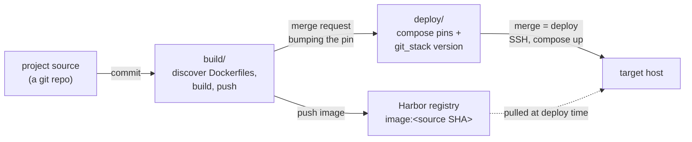

# services

Two repos that make up one self-hosted delivery pipeline, kept together
so the handoff between them is readable in one place.

| | |
|---|---|
| [**build/**](build) | builds container images from project sources, pushes them to a self-hosted Harbor registry, and opens a merge request against `deploy` to bump the pins |
| [**deploy/**](deploy) | Ansible playbooks, run from GitLab CI, that snapshot the target and update docker compose stacks on remote hosts over SSH |

The split is deliberate. `deploy` only ever consumes a pinned image
reference; `build` is where one comes from. Neither knows how the other
works beyond the merge request that passes between them.

The seam is one stack: `build/` produces `dashboard-api` and
`dashboard-worker`, and `deploy/`'s `dashboard` git_stack
(`deploy/inventory/host_vars/tools.yml`) is what consumes them.

## Sanitized fork

Both halves are sanitized copies of private repos, published so the
approach is readable rather than so it can be run as-is:

- Hostnames, domains, registry URLs, group and account names are
  `example.com` / `example-org` placeholders.
- IP addresses are RFC 5737 documentation addresses, not real hosts.
- No secret is included. Every vault file ships as a `.example` with
  `CHANGE-ME` values, and every credential the pipelines use is a CI/CD
  variable, documented in each repo's `.gitlab-ci.yml` header.
- `build/`'s real image sources are replaced with two sample projects
  under `build/projects/`, and `deploy/`'s stack list is cut to a
  representative handful (`ghost`, `homepage`, `vaultwarden`, `auth`,
  `gitlab`, `dashboard`).

The logic, the roles, the pipelines and the tests are unchanged. Each
repo's README has a "What to change if you fork this" section listing
the values that are hardcoded and have to be edited.

## License

MIT, see [LICENSE](LICENSE).
