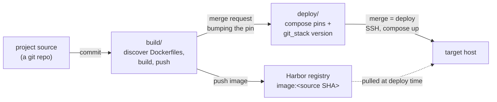

# services

Three repos that make up one self-hosted delivery pipeline, kept together
so the handoffs between them are readable in one place.

| | |
|---|---|
| [**infra/**](infra) | the hosts: Proxmox LXCs created from one inventory line, bootstrapped, kept patched, plus the CI runner (one LXC, or optionally a k3s cluster) and a minimal Proxmox API token script |
| [**build/**](build) | builds container images from project sources, pushes them to a self-hosted Harbor registry, and opens a merge request against `deploy` to bump the pins |
| [**deploy/**](deploy) | Ansible playbooks, run from GitLab CI, that snapshot the target and update docker compose stacks on remote hosts over SSH |

The split is deliberate. `deploy` only ever consumes a pinned image
reference; `build` is where one comes from. Neither knows how the other
works beyond the merge request that passes between them.

`infra` sits underneath both: it owns which hosts exist (and the runner
that executes the other two pipelines), and `deploy` can read its
inventory instead of keeping its own host list.

## What is new: the infra layer

- **[`infra/`](infra)**, the host layer: `bin/kickstart <host>` turns one
  inventory line into a running, bootstrapped Debian 13 LXC; `patch.yml`,
  `dist_upgrade.yml` and a weekly updates report keep it current.
- **A GitLab runner role** (`infra/roles/gitlab_runner`, `playbooks/runner.yml`):
  the default CI path is one LXC with Docker and `gitlab-runner`, registered
  non-interactively with a `glrt-` token from vault.
- **An optional k3s path** (`playbooks/k3s.yml`, `infra/k3s/`): three
  privileged LXCs and the `gitlab-runner` Helm chart with the Kubernetes
  executor. Heavier, only if you want Kubernetes anyway.
- **[`infra/scripts/proxmox-api-token.sh`](infra/scripts/proxmox-api-token.sh)**:
  a role, user and API token with only the privileges the playbooks need.
- **[A tutorial](docs/proxmox-tutorial.md)** from an empty Proxmox to a
  working runner and deployed stacks.

## Layout

| Path | What |
|---|---|
| `infra/inventory/` | the hosts, one line each, in numbered files; group classes in `group_vars/` |
| `infra/bin/kickstart` | create, bootstrap and base a host from its inventory line |
| `infra/playbooks/` | provision, bootstrap, base, runner, k3s, patch, dist_upgrade, reports |
| `infra/roles/` | `base`, `docker`, `tailscale`, `host_bootstrap`, `proxmox_lxc`, `proxmox_snapshot`, `proxmox_host`, `gitlab_runner`, `k3s` |
| `infra/scripts/` | `proxmox-api-token.sh`, `list_lxc_ips.sh`, `host_updates_issue.py` |
| `docs/proxmox-tutorial.md` | the walkthrough |
| `build/` | image build pipeline and its tests |
| `deploy/` | stacks, roles, pipeline |

The seam is one stack: `build/` produces `dashboard-api` and
`dashboard-worker`, and `deploy/`'s `dashboard` git_stack
(`deploy/inventory/host_vars/tools.yml`) is what consumes them.

## Sanitized fork

The repos are sanitized copies of private ones, published so the
approach is readable rather than so it can be run as-is:

- Hostnames, domains, registry URLs, group and account names are
  `example.com` / `example-org` placeholders.
- IP addresses are RFC 5737 documentation addresses, not real hosts. `infra/`'s example inventory uses
  `192.168.1.x` addresses and `pve1`/`app1`/`runner1` names instead,
  also examples: replace them with yours.
- No secret is included. Every vault file ships as a `.example` with
  `CHANGE-ME` values, and every credential the pipelines use is a CI/CD
  variable, documented in each repo's `.gitlab-ci.yml` header.
- `build/`'s real image sources are replaced with two sample projects
  under `build/projects/`, and `deploy/`'s stack list is cut to a
  representative handful (`ghost`, `homepage`, `vaultwarden`, `auth`,
  `gitlab`, `dashboard`).

The logic, the roles, the pipelines and the tests are unchanged, except
that `infra/`'s `gitlab_runner` role and the first-node handling in its
`k3s` role are new and have only been syntax-checked, not run (see
[infra/README.md](infra/README.md#what-is-verified)). Each
repo's README has a "What to change if you fork this" section listing
the values that are hardcoded and have to be edited.

## License

MIT, see [LICENSE](LICENSE).
