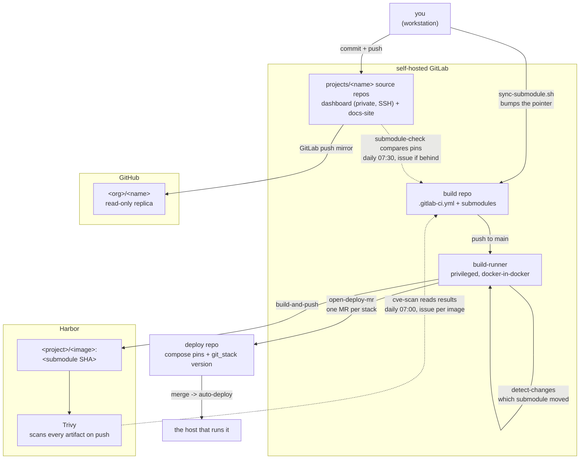

# build

Builds a fleet's own container images, pushes them to a self-hosted
Harbor registry, and opens a merge request against the companion
`deploy` repo to bump the compose pins. Merging there deploys, same as
any other change.

Kept separate from `deploy` on purpose: `deploy` only ever consumes a
pinned image reference. This repo is where one comes from.

> **Public fork.** This is a sanitized copy of a private repo. Hostnames,
> registry URLs, group names and credentials have been replaced with
> `example.com` placeholders, and the two real image sources have been
> swapped for the sample projects under `projects/`. The pipeline logic,
> the scripts and the tests are unchanged. See
> [What to change if you fork this](#what-to-change-if-you-fork-this).



## Quick reference

| | |
|---|---|
| Add an image source | `scripts/add-submodule.sh <repo-url> [name]` |
| Mirror it to GitHub | `scripts/add-mirror.sh <gitlab-path> <gh-owner/repo>` |
| Ship a change | `scripts/sync-submodule.sh <name> "message"` |
| Rebuild without a change | manual `rebuild` job, `REBUILD_SUBMODULES=<name>` |
| Run the tests | `python3 -m unittest discover -s tests` |
| Daily checks | `cve-scan` 07:00, `submodule-check` 07:30, both open issues |

Nothing hand-lists which images exist, a tracked `Dockerfile` under a
submodule is the only registration one needs.

## The sample projects

`.gitmodules` is the registry every other moving part enumerates from.
Upstream each entry is a real git submodule; here the two entries are
checked in under `projects/` directly, so the fork is clonable and the
pipeline runnable without access to a private repo.

They exist to cover the two shapes discovery has to handle:

| Project | Shape | Images produced |
|---|---|---|
| `projects/docs-site` | one `Dockerfile` at the project root | `docs-site` |
| `projects/dashboard` | nested `Dockerfile`s, a monorepo | `dashboard-api`, `dashboard-worker` |

Both `Dockerfile`s reference the dated `APT_REFRESH`/`APK_REFRESH` build
arg that `build-images.sh` passes, which is what makes a rebuild pick up
base-OS security fixes rather than restoring a byte-identical cached
layer. Copy that pattern into real projects.

## What to change if you fork this

The scripts under `scripts/` hold no infrastructure literals. Everything
they need arrives as an environment variable, so the logic is portable
as-is. What is hardcoded, and has to be edited, is this:

| Where | What |
|---|---|
| `.gitmodules` | the source repo URLs, and the SSH host and port for private ones |
| `.gitlab-ci.yml`, `.gitlab/ci/*.yml` | the job image `ghcr.io/example-org/build-ci-image:latest` |
| `.gitlab-ci.yml`, `.gitlab/ci/*.yml` | the `ssh-keyscan` line naming `ssh.gitlab.example.com` port 2224 |
| `tests/` | expected tags are spelled `registry.example.com/library/...` |
| `vault.yml.example` | copy to `vault.yml` (gitignored) and fill in |

Everything else is a CI/CD variable, documented in the header of
`.gitlab-ci.yml`: `HARBOR_URL`, `HARBOR_PROJECT`, `HARBOR_ROBOT_USER`,
`HARBOR_ROBOT_TOKEN`, `DEPLOY_API_TOKEN`, `BUILD_API_TOKEN`,
`GIT_SSH_PRIVATE_KEY`. None of them are baked into a tracked file.

## Why GitLab CI and not GitHub Actions

Harbor is internal-only. GitHub's cloud runners cannot reach it, and
exposing it just to let one push isn't worth doing. So the build runs on
a self-hosted runner on the same network, tag `build`, on its own host,
separate from the deploy runner so a slow image build never queues
behind a fleet deploy.

## Tests

```bash
python3 -m unittest discover -s tests
```

Standard library only, no pytest, no Docker, about eight seconds. That
constraint is the point: the CI job needs nothing beyond an interpreter,
so there is no reason not to run it before pushing.

`scripts/` is where this repo's real decisions live, which directories
become images, which tags get skipped, what gets written to the deploy
repo, and pushing to `main` is what builds and opens merge requests
there. So the scripts are tested directly: `fake_gitlab.py` stands in
for the API, `test_build_images.py` stubs `docker`, and
`test_pipeline.py` asserts properties of `.gitlab-ci.yml` that are easy
to drop in an edit and invisible until something ships wrong.

## License

MIT, see [LICENSE](LICENSE).
