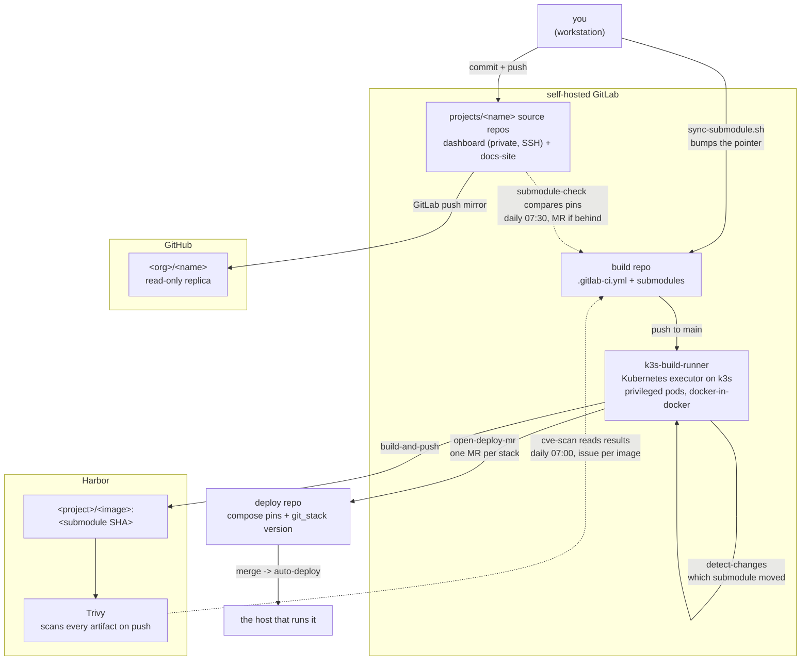

# build

Builds a fleet's own container images, pushes them to a self-hosted
Harbor registry, and opens a merge request against the companion
`deploy` repo to bump the compose pins. Merging there deploys, same as
any other change.

Kept separate from `deploy` on purpose: `deploy` only ever consumes a
pinned image reference. This repo is where one comes from.

> **Public fork.** This is a sanitized copy of a private repo. Hostnames,
> registry URLs, group names and credentials have been replaced with
> `example.com` placeholders, and the two real image sources have been
> swapped for the sample projects under `projects/`. The pipeline logic,
> the scripts and the tests are unchanged. See
> [What to change if you fork this](#what-to-change-if-you-fork-this).



## Quick reference

| | |
|---|---|
| Add an image source | `scripts/add-submodule.sh <repo-url> [name]` |
| Mirror it to GitHub | `scripts/add-mirror.sh <gitlab-path> <gh-owner/repo>` |
| Ship a change | `scripts/sync-submodule.sh <name> "message"` |
| Rebuild without a change | manual `rebuild` job, `REBUILD_SUBMODULES=<name>` |
| Run the tests | `python3 -m unittest discover -s tests` |
| Daily checks | `cve-scan` 07:00 opens issues, `submodule-check` 07:30 opens a bump MR |

Nothing hand-lists which images exist, a tracked `Dockerfile` under a
submodule is the only registration one needs.

## How it works

### The unit of change is a pointer

Source lives in its own repos and appears here as submodules under
`projects/`. This repo stores only a SHA per submodule, the gitlink, and
moving that SHA is what triggers everything else.

That choice shapes the pipeline. `git diff --name-only` reports a
submodule as a change to its own path, never to a file inside it, so
`detect-changes` learns which submodule moved without fetching any
submodule content, which matters because `dashboard` is private and needs
an SSH identity to fetch at all. The cost is that it cannot tell what
inside one moved either, so a multi-image submodule rebuilds all of its
images whenever its pointer moves.

It also means a pointer moved backwards silently un-ships a change:
nothing fails, the pipeline is green, and the fix simply is not in the
image. `sync-submodule.sh` refuses to bump from a detached HEAD for
that reason, and `submodule-check` proposes bumps as a merge request
rather than as commands to retype.

### What a push to main does

| Stage | Job | |
|---|---|---|
| `validate` | `test` | stdlib unittest, and the only job a merge request runs |
| `detect` | `detect-changes` | diffs the push range against `.gitmodules`, writes `changed_submodules.txt` |
| `build` | `build-and-push` | checks out submodules over SSH, builds, pushes to Harbor |
| `open-mr` | `open-deploy-mr` | bumps the pins in `services/deploy`, one merge request per stack |

Merging that merge request is what redeploys, via deploy's own
auto-deploy.

### How an image gets its name and tag

`discover-images.sh` names an image after its submodule, or
`<submodule>-<subdir>` when the `Dockerfile` is nested. Two contexts
resolving to one name is an error rather than a warning, both would
push the same Harbor tag.

`build-images.sh` tags each image with the submodule's own short commit
SHA, and skips the build when Harbor already holds that tag, so the
same source is a no-op however often it runs. `FORCE_REBUILD=true`
overrides that, which is right for a rebuild against a patched base
image and wrong under a stack that already deployed the tag.

Two files carry the result forward: `built_images.env` for the image
tags, `built_submodules.tsv` for the checkout pins. `open_deploy_mr.py`
bumps both, and only ever edits something already pointing at this
exact artifact, never creating a stack and never guessing.

### Two ways to build, one code path

`build-and-push` runs on a push, `rebuild` is the manual lever
(`REBUILD_SUBMODULES`, `FORCE_REBUILD`) so recovering never requires an
empty submodule bump. Both run `build-images.sh`.

`open-deploy-mr` names neither in `needs:`. A manual job named there
skips its dependents whenever nobody plays it, so this one waits on
stage order instead and collects artifacts from whichever producer
actually ran.

### Why the rules look paranoid

A push to `main` is the thing that publishes, so what may cause one is
the whole of this repo's security surface. A scheduled pipeline still
has `CI_COMMIT_BRANCH == main`, so without an explicit refusal it would
satisfy `.main_only` and start pushing images on a timer. Hence the
workflow rules letting a schedule create a pipeline for only the two
named tasks, the separate `schedule -> never` guard on every publishing
job on top of that, and `tests/test_pipeline.py` asserting both halves
so neither can be quietly dropped in an edit.

The same reasoning covers the rest. Merge request pipelines run `test`
only. `resource_group` serialises registry pushes and merge request
writes, separately, so neither queues behind the other. The daily bump
opens a merge request and never commits to `main`, and a test keeps it
from merging what it opens. Jobs are deliberately not `interruptible`,
because `detect-changes` only diffs its own push range, so a cancelled
pipeline would take an unbuilt bump with it.

## Why GitLab CI and not GitHub Actions

Harbor is internal-only. GitHub's cloud runners cannot reach it, and
exposing it just to let one push isn't worth doing. So the build runs on
a self-hosted runner on the same network, tag `build`:
a `k3s-build-runner` on a k3s cluster (Kubernetes executor, privileged
pods for dind), set up in
[j551n-ncloud/k3s-lxc](https://github.com/j551n-ncloud/k3s-lxc), separate
from `deploy`'s `k3s-runner` so a slow image build never queues behind a
fleet deploy. It replaced docker-executor runner LXCs; a host alias for
`registry.example.com -> 192.0.2.4` is part of its config.

## What to change if you fork this

The scripts under `scripts/` hold no infrastructure literals. Everything
they need arrives as an environment variable, so the logic is portable
as-is. What is hardcoded, and has to be edited, is this:

| Where | What |
|---|---|
| `.gitmodules` | the source repo URLs, and the SSH host and port for private ones |
| `.gitlab-ci.yml`, `.gitlab/ci/*.yml` | the job image `ghcr.io/example-org/build-ci-image:latest` |
| `.gitlab-ci.yml`, `.gitlab/ci/*.yml` | the `ssh-keyscan` line naming `ssh.gitlab.example.com` port 2224 |
| `tests/` | expected tags are spelled `registry.example.com/library/...` |
| `vault.yml.example` | copy to `vault.yml` (gitignored) and fill in |

Everything else is a CI/CD variable, documented in the header of
`.gitlab-ci.yml`: `HARBOR_URL`, `HARBOR_PROJECT`, `HARBOR_ROBOT_USER`,
`HARBOR_ROBOT_TOKEN`, `DEPLOY_API_TOKEN`, `BUILD_API_TOKEN`,
`GIT_SSH_PRIVATE_KEY`. None of them are baked into a tracked file.

## Why GitLab CI and not GitHub Actions

Harbor is internal-only. GitHub's cloud runners cannot reach it, and
exposing it just to let one push isn't worth doing. So the build runs on
a self-hosted runner on the same network, tag `build`, on its own host,
separate from the deploy runner so a slow image build never queues
behind a fleet deploy.

## Tests

```bash
python3 -m unittest discover -s tests
```

Standard library only, no pytest, no Docker, about eight seconds. That
constraint is the point: the CI job needs nothing beyond an interpreter,
so there is no reason not to run it before pushing.

`scripts/` is where this repo's real decisions live, which directories
become images, which tags get skipped, what gets written to the deploy
repo, and pushing to `main` is what builds and opens merge requests
there. So the scripts are tested directly: `fake_gitlab.py` stands in
for the API, `test_build_images.py` stubs `docker`, and
`test_pipeline.py` asserts properties of `.gitlab-ci.yml` that are easy
to drop in an edit and invisible until something ships wrong.

## License

MIT, see [LICENSE](LICENSE).
