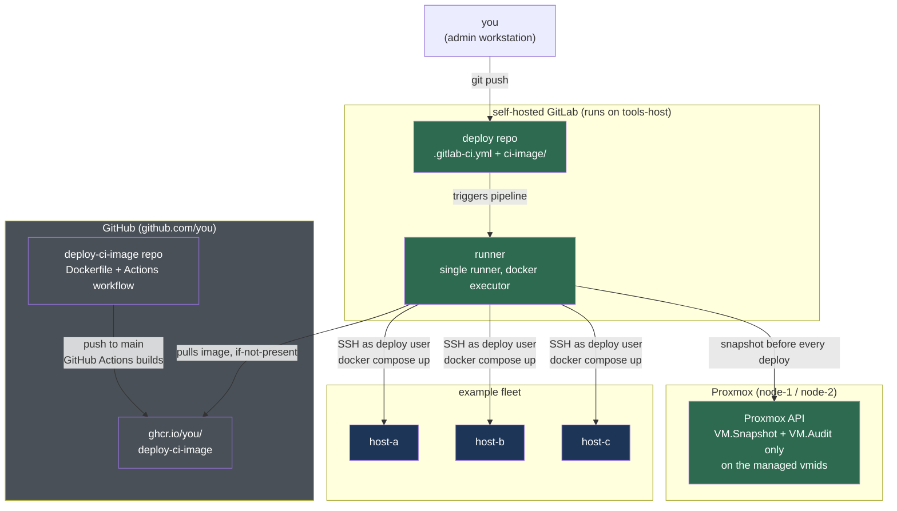
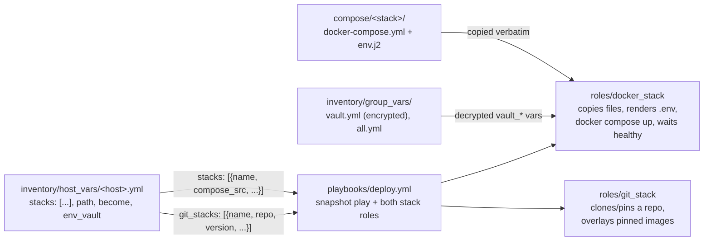
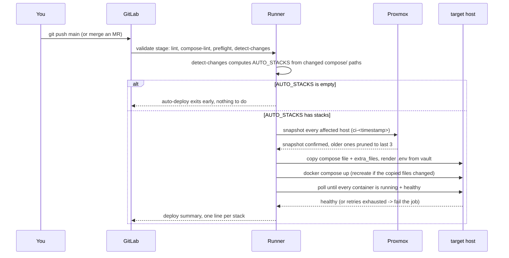
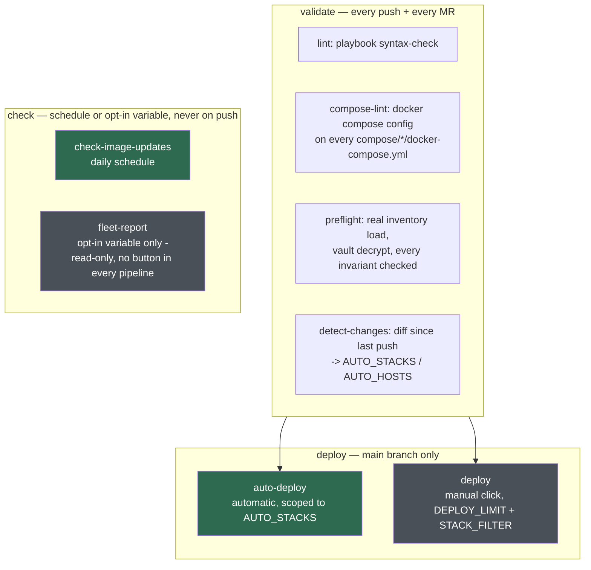
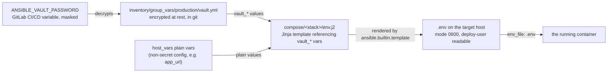
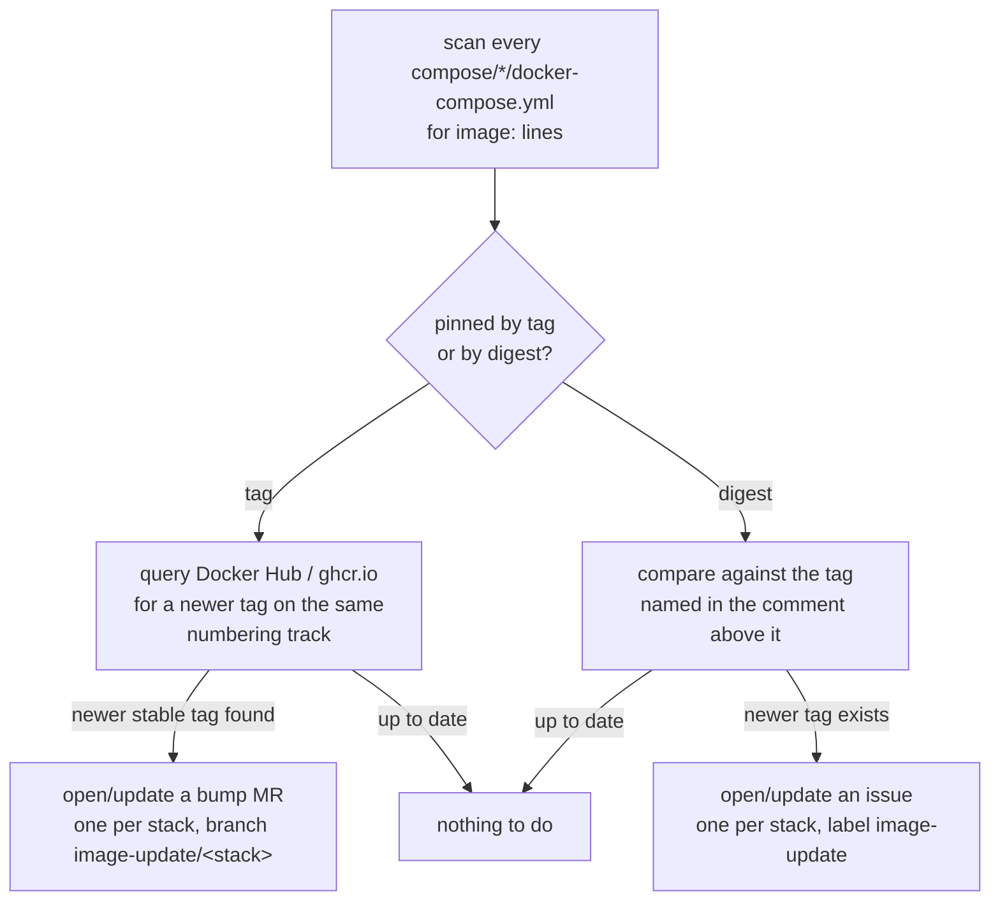

# Architecture

How this repo, its pipeline, and the example fleet it manages fit
together. `README.md` is the quick-start; `ROADMAP.md` is what's open
right now. This is the reference for how the whole thing works.

All hostnames, IPs, and domains below are placeholders.

## System overview

Three systems, deliberately kept separate:

- **GitHub** builds and hosts the CI image, so the single self-hosted
  runner never installs `ansible-core`/`git`/`openssh-client` fresh on
  every job - see `ci-image/README.md`.
- **GitLab** (self-hosted, running as one of the managed stacks itself)
  owns the pipeline definition and runs the actual jobs.
- **Proxmox** is only ever talked to for snapshots/audit, never for
  provisioning. The API token's ACL is deliberately narrow - it cannot
  roll back a snapshot, only create/list/prune one, and only on the
  vmids it's been granted.

## Repo layout

A stack only needs two things to exist: a `compose/<name>/` directory,
and an entry in some host's `host_vars/<host>.yml` `stacks:` list
pointing at it. Everything else - directory creation, `.env` rendering,
pull/recreate, the health-check wait - is the same generic
`docker_stack` role for every stack, no per-stack code path.

Two roles exist alongside it for the cases that shape does not fit:

- **`roles/git_stack`** - for a stack whose deployable unit is a whole
  git repo rather than a compose file this repo owns. It checks the repo
  out at a pinned `version:`, renders the same `env.j2`, and applies a
  `compose_overlay` from `compose/<name>/` that pins the images so the
  target never builds. This is the half the companion `build` pipeline
  writes to: it builds the images and opens the merge request that moves
  the pin. See `inventory/host_vars/tools.yml`.
- **`roles/gitlab_config`** - a single-purpose role for settings that
  cannot be passed through compose at all. The GitLab image ignores
  `GITLAB_OMNIBUS_CONFIG` when a `gitlab.rb` already exists, so SMTP,
  OIDC and nginx settings are rendered into that file directly instead.

## How a deploy actually happens

`gitlab` itself (not part of this example fleet) is the one stack this
can never touch - `FORBIDDEN_STACKS` refuses it even if asked by name,
because recreating the GitLab container would kill the pipeline
running the recreate. Deploy that one from a local `ansible-playbook`
run instead.

## The pipeline's three stages

Every job outside `check` (`lint`, `compose-lint`, `preflight`,
`detect-changes`, `deploy`, `auto-deploy`) carries a
`$CI_PIPELINE_SOURCE == "schedule"` -> `when: never` guard first in its
`rules:`, so the daily image-check schedule (or any future one) can
never accidentally also trigger a real deploy.

`resource_group: production` on both `deploy` jobs means only one
deploy can run at a time fleet-wide, even across two separate
pipelines - prevents two concurrent runs racing `docker compose` on
the same host.

## Secrets

Nothing secret ever touches a compose file directly - every stack that
needs a real secret sets `env_vault: true` in its `host_vars` entry and
reads it via `env.j2`. `preflight` renders every `env.j2` on every push
specifically to catch a missing vault key before it reaches a real
deploy, not after. (`inventory/group_vars/production/vault.yml` itself
is not included in this sanitized copy - see
`vault.yml.example` for its shape.)

## Daily image-update check

The split is deliberate: a plain tag bump (`ghost:6.45.0` ->
`6.63.0`) is routine enough to be one click to merge. A digest-pinned
image was pinned that way on purpose - usually because the tag doesn't
reproduce what's actually running, or because a migration risk was
called out by hand - so it only ever gets an issue, never a one-click
MR. Neither path ever edits a compose file without a human merging it;
nothing here auto-deploys.

## Where things run, physically (example topology)

| what | lives on |
|---|---|
| GitLab instance | `tools-host`, stack `gitlab` |
| GitLab Runner | same Proxmox cluster, its own host |
| `ci-image` builds | GitHub Actions (not this fleet at all) |
| Proxmox snapshots | taken via API from the runner, stored on each host's own node |

The runner deliberately does not live on any host this pipeline
deploys to - recreating a stack on the runner's own host would kill the
job mid-run.
