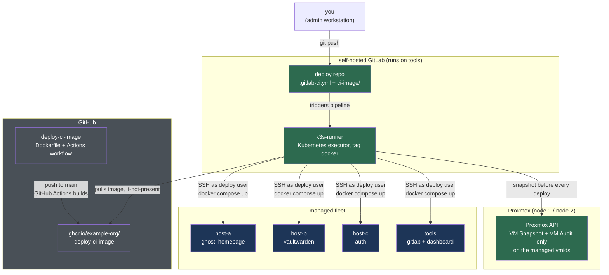

# deploy

Ansible playbooks, run from a self-hosted GitLab CI pipeline, that update
docker compose stacks on remote hosts over SSH.

A service is a `docker-compose.yml` in `compose/<name>/`. A host's
`inventory/host_vars/<host>.yml` lists which stacks it runs. Pushing a
compose change to `main` snapshots the target and deploys that stack,
and nothing else.

> **Public fork.** This is a sanitized copy of a private repo. Hostnames,
> IPs (now RFC 5737 documentation addresses), domains and credentials
> have been replaced with placeholders, and the stack list has been cut
> to a representative handful. The playbooks, roles and pipeline are
> unchanged. See [What to change if you fork this](#what-to-change-if-you-fork-this).

## Quick reference

| | |
|---|---|
| Deploy one stack | merge to `main`, or the manual `deploy` job with `STACK_FILTER=<name>` |
| Deploy locally | `ansible-playbook -i inventory/ playbooks/deploy.yml --limit <host> -e stack_filter=<name>` |
| Check before deploying | `ansible-playbook -i inventory/ playbooks/preflight.yml --vault-password-file .vault_pass.txt` |
| Add a secret | `ansible-vault encrypt_string --vault-password-file .vault_pass.txt` |
| See the fleet | `ansible-playbook -i inventory/ playbooks/fleet_report.yml` |

## Before you change anything in here

- **A stack's directory basename is its compose project name**, which
  prefixes volume and network names. Renaming the directory orphans the
  data.
- **`group_vars/` and `host_vars/` must stay inside `inventory/`.** At
  the repo root Ansible ignores them silently and the run still exits 0.
- **`gitlab` is never deployed by CI**, it runs the pipeline. Local runs
  only, via `scripts/deploy_gitlab.sh`.
- **CI runs on a k3s runner cluster** (Kubernetes executor, jobs tagged
  `docker`), set up in
  [j551n-ncloud/k3s-lxc](https://github.com/j551n-ncloud/k3s-lxc). The
  former docker-executor runner LXCs are gone. A host alias for the
  registry (`registry.example.com -> 192.0.2.4`) lives in the runner's
  Helm values.
- **Adopting a host needs a Proxmox ACL entry**, or its deploy fails
  closed on a `403`.

`playbooks/preflight.yml` asserts the first two.

## The three kinds of stack

| Role | For | Example |
|---|---|---|
| `roles/docker_stack` | the normal case: a compose file this repo owns | `ghost`, `homepage`, `vaultwarden`, `auth` |
| `roles/git_stack` | a whole git repo is the deployable unit, pinned by commit, with an image overlay on top | `dashboard` on `tools` |
| `roles/gitlab_config` | settings that cannot go through compose at all | `gitlab` on `tools` |

`git_stack` is the half the companion [`build`](../build) pipeline writes
to: it builds the images, pushes them to the registry, and opens a merge
request here that moves the `version:` pin and the image tags in
`compose/dashboard/docker-compose.yml`. Merging deploys.

## What to change if you fork this

| Where | What |
|---|---|
| `inventory/hosts.ini` | every host and address |
| `inventory/host_vars/*.yml` | which stacks run where, plus `proxmox_node`/`proxmox_vmid` |
| `inventory/group_vars/production/vault.yml.example` | copy to `vault.yml`, encrypt it, fill it in |
| `inventory/group_vars/production/vault_dashboard.yml.example` | same, for the git_stack |
| `roles/host_bootstrap/defaults/main.yml` | `deploy_public_key` is a placeholder |
| `ci-image/Dockerfile` | published to `ghcr.io/example-org/deploy-ci-image` |
| `compose/*/` | the stacks themselves |

CI/CD variables (`ANSIBLE_VAULT_PASSWORD`, `SSH_PRIVATE_KEY`,
`PROXMOX_*`, `GITLAB_API_TOKEN`) are documented in the header of
`.gitlab-ci.yml`. None of them are baked into a tracked file.

## Documentation

| | |
|---|---|
| [ARCHITECTURE.md](ARCHITECTURE.md) | system overview, repo layout, how a deploy happens, secrets |
| [ROADMAP.md](ROADMAP.md) | what is managed, what deliberately is not, and why |

## License

MIT, see [LICENSE](LICENSE).
