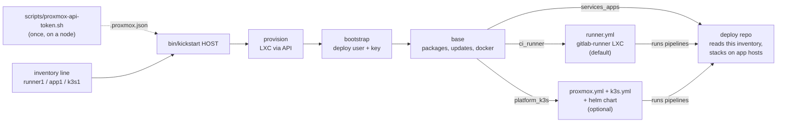

# Run it on your own Proxmox

From an empty Proxmox to a GitLab runner that deploys your stacks, using
the [`infra/`](../infra) repo of this project. The default path is **one
LXC as GitLab runner**. A three-node k3s runner cluster is an optional,
heavier second path (section 8).

> **What is verified, honestly.** The author of this sample could not run
> it against a real Proxmox while writing it. What was checked: inventory
> parsing, `ansible-playbook --syntax-check` on every playbook, `bash -n`
> on every script, template rendering for k3s, and the token script
> against a fake `pveum`. What was **not** run: creating LXCs, snapshots,
> patching, the Debian upgrade, the `gitlab_runner` role, `k3s.yml` and
> the Helm values. The roles other than `gitlab_runner` come from a
> working private setup; expect to fix small things on the first run and
> use `--check` and snapshots as your safety net.



## 0. Prerequisites

- A Proxmox VE 8 or 9 node or cluster, with storage that can **snapshot**
  (LVM-thin, ZFS or btrfs; plain directory storage cannot, and
  `patch.yml` fails closed without a snapshot).
- A Debian 13 container template: `pveam update && pveam download local <name>`
  on a node, then `pveam list local` shows the exact file name.
- A static address range on the LAN that your DHCP server does not hand out.
- A GitLab: gitlab.com or your own instance, with a project to build and
  deploy from.
- A workstation with Python 3, `git`, `ssh` and `ping`. This is the
  Ansible controller; it must reach the Proxmox API (8006) and the new
  containers over SSH (22).
- An SSH key pair for the deploy user, for example:

  ```
  ssh-keygen -t ed25519 -f ~/.ssh/infra_deploy -C deploy
  ssh-add ~/.ssh/infra_deploy
  ```

  Keep the private half in `ssh-agent` (or `~/.ssh/config`). The public half
  goes into the inventory in step 2.

```
git clone <this repo> && cd git-iac/infra
python3 -m venv .venv && . .venv/bin/activate
pip install ansible-core
ansible-galaxy collection install -r requirements.yml
```

## 1. Create the Proxmox API token

Copy `infra/scripts/proxmox-api-token.sh` to one Proxmox node and run it
as root. It creates a role with the minimal privileges the playbooks
need, a user `infra@pve`, an API token with privilege separation, and the
ACL. It is idempotent; read its header for the privilege list and the
points it could not verify.

```
scp scripts/proxmox-api-token.sh root@<node>:
ssh root@<node> 'bash proxmox-api-token.sh' > .proxmox.json
chmod 600 .proxmox.json
```

Proxmox prints the token secret **once**, and the script puts it into the
JSON on stdout. `.proxmox.json` is gitignored: keep it that way, and
store a copy in a password manager. If you lose it, run the script again
with `--rotate`.

Check it:

```
curl -sk -H "Authorization: PVEAPIToken=$(jq -r .proxmox_api_token_id .proxmox.json)=$(jq -r .proxmox_api_token_secret .proxmox.json)" \
  "$(jq -r .proxmox_api_url .proxmox.json)/api2/json/version"
```

If creating a privileged container (k3s, section 8) is answered with a
403, that is the Proxmox rule that some container features are
`root@pam` only; see the script header.

## 2. Fill in the inventory

Everything is an example until you change it:

| File | Change |
|---|---|
| `inventory/group_vars/all.yml` | `deploy_public_key` (your public key), `lxc_gateway`, `lxc_nameserver`, `lxc_bridge`, `lxc_storage`, `lxc_template`, the address pool |
| `inventory/05-proxmox` | your node names (exactly as the Proxmox UI shows them) and their addresses; `ansible_user` is root for these |
| `inventory/group_vars/ci_runner/vars.yml` | `gitlab_runner_url` |
| `inventory/0x-*` | your hosts, one line each |

A host is one line: `name  ansible_host=...  proxmox_node=...  proxmox_vmid=...`
plus only the sizes that differ from its group (`lxc_memory=4096`). Group
defaults live in `group_vars/` (a class system: `all.yml`, then the
group, then the line). A stopped host stays in its group, commented out
with a reason. See `inventory/README.md`.

```
ansible-inventory --graph        # groups resolve as you intended?
```

## 3. Find a free vmid, address and node

```
bin/kickstart --free
```

It reads the cluster through the API and prints the next vmid, free
addresses from your pool (not in the inventory, not answering ping) and
the node with the most free RAM, as a ready inventory line.

## 4. The runner LXC

Add the line to `inventory/03-platform`:

```
[ci_runner]
runner1        ansible_host=192.168.1.41    proxmox_node=pve1  proxmox_vmid=140
```

then preview and create:

```
bin/kickstart runner1 --check
bin/kickstart runner1
```

`kickstart` runs three playbooks for that one host: `provision.yml`
(creates the LXC through the API, the deploy key goes into root's
`authorized_keys`), `bootstrap.yml` (deploy user, key, sudo, `/opt/stacks`)
and `base.yml` (packages, unattended security updates, Docker CE because
`ci_runner` is in `docker_hosts`). Run it again later and it only
compares the LXC with the inventory and re-applies bootstrap and base.

Keep the runner **off** the hosts that deploy stacks: recreating a stack on
the runner's own host can kill the job that is doing it.

### Register it with GitLab

1. GitLab: **Settings > CI/CD > Runners > New project runner** (or a group
   runner). Set the **tags** and "run untagged jobs" there. With an
   authentication token they are fixed at creation, and
   `gitlab-runner register` refuses them on the command line. Copy the
   `glrt-...` token, it is shown once.
2. Encrypt it into the inventory:

   ```
   openssl rand -base64 24 > .vault_pass.txt && chmod 600 .vault_pass.txt   # once
   cp inventory/group_vars/ci_runner/vault_gitlab_runner.yml.example \
      inventory/group_vars/ci_runner/vault_gitlab_runner.yml
   ansible-vault encrypt_string --vault-password-file .vault_pass.txt \
      --name vault_gitlab_runner_token 'glrt-...'
   ```

   Paste the output over the placeholder line in `vault_gitlab_runner.yml`
   (it is gitignored, and `.vault_pass.txt` too). Back the vault password
   up somewhere safe: without it the value is gone.
3. Run the role:

   ```
   ansible-playbook playbooks/runner.yml --vault-password-file .vault_pass.txt --check
   ansible-playbook playbooks/runner.yml --vault-password-file .vault_pass.txt
   ```

   It adds GitLab's apt repo, installs `gitlab-runner`, puts its user in
   the `docker` group, registers with the docker executor (skipped if
   `/etc/gitlab-runner/config.toml` already holds the token), and sets
   `concurrent` from `gitlab_runner_concurrent`. The runner shows as online
   in the GitLab UI within a minute. Run a pipeline with a job whose tags
   match.

If `apt update` complains that GitLab's repo has no `trixie` suite, set
`gitlab_runner_apt_suite: bookworm` in `ci_runner/vars.yml`.

## 5. App hosts

Add them to `[services_apps]` in `inventory/02-services` and kickstart each:

```
bin/kickstart app1
bin/kickstart app2
```

They get the deploy user with sudo, `/opt/stacks` and Docker. `services_apps`
is also in `managed`, the group the deploy repo targets.

## 6. Point deploy at this inventory

In `deploy/ansible.cfg`:

```ini
[defaults]
inventory = ../infra/inventory, inventory/
```

and in deploy's `.gitlab-ci.yml`, clone infra before running Ansible with
the job token (infra must allow the deploy project under **Settings >
CI/CD > Job token permissions**):

```yaml
- |
  rm -rf "$CI_PROJECT_DIR/../infra"
  git clone --quiet --depth 1 --branch "${INFRA_REF:-main}" \
    "https://gitlab-ci-token:${CI_JOB_TOKEN}@${CI_SERVER_HOST}/<group>/infra.git" \
    "$CI_PROJECT_DIR/../infra"
```

Stack secrets stay in deploy, one file and one `!vault` value per key:
`inventory/group_vars/production/vault_<stack>.yml`, committed only as
`.yml.example`. Add the `PROXMOX_*` CI/CD variables (the same token, or a
second one with only `VM.Snapshot` and `VM.Audit`) so deploys snapshot
first. Details in [`infra/README.md`](../infra/README.md#how-deploy-reads-this-inventory).

## 7. Patching and the updates report

| | |
|---|---|
| Security updates | daily, automatic, by `unattended-upgrades` (set up by `base.yml`). Docker and containerd are excluded because a daemon restart restarts every container. |
| `ansible-playbook playbooks/patch.yml -e @.proxmox.json` | everything else, one host at a time: snapshot (`patch-*`, newest 2 kept), full-upgrade, reboot if needed, wait for containers and `patch_services` |
| `ansible-playbook playbooks/dist_upgrade.yml -e @.proxmox.json --limit <host>` | Debian 12 to 13, snapshot first (`dist-*`), skips hosts with `apt_holds` |
| `ansible-playbook playbooks/updates_report.yml` | read-only: pending updates, security count, reboot flag per host, into `host_updates.json` |
| `ansible-playbook playbooks/snapshot_report.yml -e @.proxmox.json` | read-only: all snapshots, who made them, which get pruned |

`.gitlab-ci.yml` runs `updates_report.yml` on a schedule (CI/CD > Schedules,
variable `SCHEDULE_TASK=check-host-updates`, for example `0 7 * * 1`) and
`scripts/host_updates_issue.py` keeps one issue up to date that closes
itself when everything is current. Set `SSH_PRIVATE_KEY` and
`GITLAB_API_TOKEN` as CI/CD variables for it. Patching itself stays a
manual run, on purpose.

Always `--check --diff` first, and run it with `--limit <host>` the first time.

## 8. Optional: a k3s runner cluster (heavier)

Only worth it if you want Kubernetes anyway. It needs three privileged
LXCs, host kernel changes on every Proxmox node, a pinned k3s version and
Helm. One runner LXC (section 4) is simpler and enough for most homelabs.

1. Uncomment `k3s1` to `k3s3` in `inventory/03-platform` (one per node, so
   the etcd quorum survives one node down; 2 cores and 8 GB each by default).
2. Prepare the hypervisors once (modules `overlay`, `br_netfilter`, sysctls):

   ```
   ansible-playbook playbooks/proxmox.yml --check --diff
   ansible-playbook playbooks/proxmox.yml
   ```
3. Create the nodes. `lxc_unprivileged: false` and the raw `lxc.*` lines
   come from `group_vars/platform_k3s/lxc.yml`; the Proxmox API cannot set
   the raw lines, so `provision.yml` writes them into
   `/etc/pve/nodes/<node>/lxc/<vmid>.conf` over SSH as root on the node
   before the first start:

   ```
   bin/kickstart k3s1 && bin/kickstart k3s2 && bin/kickstart k3s3
   ```
4. The join token, from vault (see `vault_k3s.yml.example`), then install:

   ```
   ansible-playbook playbooks/k3s.yml --vault-password-file .vault_pass.txt --check
   ansible-playbook playbooks/k3s.yml --vault-password-file .vault_pass.txt
   ```

   One node at a time. The first node in `[platform_k3s]` starts the
   cluster (`cluster-init`), the others join through it; set
   `k3s_version` in `roles/k3s/defaults/main.yml` to a current release first.
5. The runner, on a k3s server (`sudo k3s kubectl ...`) or from your
   workstation with the copied `/etc/rancher/k3s/k3s.yaml`:

   ```
   cp k3s/gitlab-runner.values.yaml.example k3s/gitlab-runner.values.yaml
   $EDITOR k3s/gitlab-runner.values.yaml          # gitlabUrl
   kubectl create namespace gitlab-runner
   kubectl -n gitlab-runner create secret generic runner-docker \
     --from-literal=runner-token='glrt-...' --from-literal=runner-registration-token=''
   helm repo add gitlab https://charts.gitlab.io
   helm upgrade --install gitlab-runner gitlab/gitlab-runner \
     -n gitlab-runner -f k3s/gitlab-runner.values.yaml
   ```

   The token is created in the GitLab UI like in section 4 and lives only in
   the Kubernetes Secret, never in the values file. Jobs then run as pods
   (Kubernetes executor). Check the values against your chart version with
   `helm show values gitlab/gitlab-runner`.

If you rebuild the first k3s node from scratch, move another node to the
top of the group first, or it would start a new cluster instead of rejoining.

## 9. Troubleshooting

| Symptom | Look at |
|---|---|
| `bin/kickstart` says `.proxmox.json` is missing | step 1; run it from the `infra/` directory |
| `403` or `Permission check failed` from the API | `pveum acl list`, the token needs the role on `/` (or your pool, storage and bridge); privilege separation means the token and its user both need the ACL |
| `proxmox_lxc` assertion about `deploy_public_key` | replace the placeholder in `inventory/group_vars/all.yml` |
| LXC creation fails on the template | `pveam list local` and `lxc_template`; the storage must hold CT templates |
| "address must be free" | the IP answers ping; pick one from `bin/kickstart --free` |
| `Permission denied (publickey)` after create | `ssh-add -l` shows the key whose public half is `deploy_public_key`; the container was created with that key |
| Snapshot step fails | storage that cannot snapshot (directory storage); use LVM-thin, ZFS or btrfs |
| Runner offline, jobs stuck | `systemctl status gitlab-runner` and `journalctl -u gitlab-runner` on the LXC; tags in the job must match the runner's |
| Docker builds in jobs fail | `gitlab_runner_docker_privileged` is false by default; docker-in-docker needs it (only for runners of your own, protected projects) |
| `ansible.cfg` ignored in CI | the checkout is world-writable; set `ANSIBLE_CONFIG` explicitly and `chmod go-w "$CI_PROJECT_DIR"` |
| Hosts missing from `base.yml` | they are not in `[base]` (see `99-organisational_groups`) |

> **Lessons**
>
> - **Tailscale accept-routes on subnet routers.** Leave it off on every
>   router. A standby router that accepts the primary's LAN route installs
>   it in routing table 52, which beats the main table, and then answers LAN
>   clients through `tailscale0`: SSH and CI to it time out while everything
>   looks up. `group_vars/edge_vpn.yml` sets it false and `roles/tailscale`
>   enforces it.
> - **Read every byte before a dist-upgrade.** Run `--check --diff`, read
>   the whole package list and every config file it would replace, and do
>   hosts one at a time. A snapshot is a rollback, not a review. The
>   playbook keeps your config files (`confold`) and stops at the first
>   failure, but only you know which package you cannot lose.
> - **Docker restarts are outages.** Daemon upgrades restart every
>   container, so they are excluded from automatic updates and happen in
>   `patch.yml` after a snapshot, or are held with `apt_holds`.
> - **Do not run the runner where it deploys.** A job that recreates its own
>   host's containers can kill itself mid-run.
