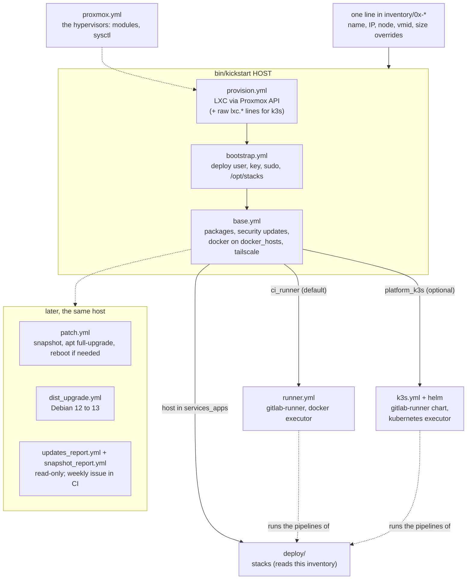

# infra

The hosts themselves: which Proxmox guests exist, how they are prepared,
which packages they carry and how they get updated. What runs on them
(docker stacks) lives in [`deploy/`](../deploy), which can read this
repo's inventory.

| | |
|---|---|
| **infra** (this) | hosts: create the LXC, bootstrap, base packages and security updates, Debian upgrades, the CI runner, optional k3s nodes |
| [**deploy**](../deploy) | stacks: compose projects on those hosts |

Step by step on your own Proxmox: [docs/proxmox-tutorial.md](../docs/proxmox-tutorial.md).

> **Sample inventory.** Every address (`192.168.1.x`), node (`pve1` to
> `pve3`) and host name (`app1`, `runner1`, `k3s1`) here is an example.
> Nothing in this directory has been run against a real Proxmox by the
> person who published it; see "What is verified" below.



| Path | What |
|---|---|
| `inventory/` | every Proxmox guest (`##-name` files, see `inventory/README.md`), groups, vmid/node and host settings (`host_vars/`) |
| `bin/kickstart <host>` | **a new LXC**: write its line into `inventory/0x-*`, then this creates it, bootstraps it and applies base (`playbooks/kickstart.yml`). `--check` previews, `bin/kickstart --free` suggests vmid, IP and node |
| `scripts/proxmox-api-token.sh` | run as root on one Proxmox node: a minimal role, user and API token, prints the `.proxmox.json` template |
| `playbooks/provision.yml` | creates LXCs the inventory has and Proxmox doesn't; compares existing ones, never changes them |
| `playbooks/bootstrap.yml` | one-time host setup: deploy user, key, `/opt/stacks`, sudo |
| `playbooks/base.yml` | base packages, apt holds, unattended security updates, Tailscale settings, Docker CE on `[docker_hosts]` |
| `playbooks/runner.yml` | **default CI path**: `gitlab-runner` from GitLab's apt repo on `[ci_runner]`, docker executor, registered with a `glrt-` token from vault |
| `playbooks/proxmox.yml` | the Proxmox nodes themselves (`proxmox_nodes`, as root): kernel modules and sysctls for k3s LXCs |
| `playbooks/k3s.yml` | **optional**: k3s servers (`platform_k3s`), one at a time: pinned version, `config.yaml` (token from vault), restart only on change, wait for Ready |
| `k3s/gitlab-runner.values.yaml.example` | **optional**: Helm values for the `gitlab-runner` chart, Kubernetes executor |
| `playbooks/dist_upgrade.yml` | Debian 12 to 13, one host at a time, snapshot first; skips hosts with `apt_holds` |
| `playbooks/patch.yml` | full apt upgrade, one host at a time, snapshot first, reboot if needed |
| `playbooks/snapshot_report.yml` | read-only: every Proxmox snapshot per LXC, which tool made it, whether it gets pruned |
| `playbooks/updates_report.yml` | read-only: pending updates per host, fed by `scripts/host_updates_issue.py` into one GitLab issue |
| `scripts/list_lxc_ips.sh` | run on a node: prints inventory lines for LXCs you already have |
| `.gitlab-ci.yml` | validates (inventory graph, syntax check of every playbook) and runs the weekly updates report |

```
bin/kickstart --free                    # suggests vmid, IP, node for a new inventory line
bin/kickstart <host> --check            # then without --check
ansible-playbook playbooks/base.yml --check --diff
ansible-playbook playbooks/patch.yml -e @.proxmox.json --limit <host>
```

`.proxmox.json` (gitignored) holds `proxmox_api_url`,
`proxmox_api_token_id` and `proxmox_api_token_secret`. The script above
prints it. Never commit it.

## Why it is split from deploy

Creating and patching a host is rare, root-ish and needs the Proxmox
API. Deploying a stack is routine, runs from CI and needs only SSH to the
deploy user. Keeping them apart means the CI token that deploys stacks
never needs the right to create or delete guests, and a bad inventory
edit is reviewed in the repo that owns hosts.

Applying anything to hosts (bootstrap, base, patch, upgrades) is run by
hand on purpose, not from CI: patching the GitLab host or the runner
restarts the thing that would run the job. CI only validates and reports.

## How deploy reads this inventory

`deploy/ansible.cfg` can list two inventory sources, later ones win:

```ini
[defaults]
inventory = ../infra/inventory, inventory/
```

so hosts, groups, `ansible_host`, `proxmox_node` and `proxmox_vmid` come
from here and deploy's own `inventory/` only adds stack variables and
secrets. In CI the job clones this repo next to deploy before running
Ansible, using the job token (this project must list deploy under
Settings > CI/CD > Job token permissions):

```yaml
before_script:
  - |
    rm -rf "$CI_PROJECT_DIR/../infra"
    git clone --quiet --depth 1 --branch "${INFRA_REF:-main}" \
      "https://gitlab-ci-token:${CI_JOB_TOKEN}@${CI_SERVER_HOST}/<group>/infra.git" \
      "$CI_PROJECT_DIR/../infra"
```

The sample `deploy/` in this repository still ships its own
self-contained `inventory/hosts.ini`, so it runs without infra. To switch
it over, make the two edits above, delete its `hosts.ini`/`groups.ini`
host lines, and keep `managed` in `99-organisational_groups` (deploy's
preflight asserts it matches the hosts that define stacks).

Secrets follow the same pattern in both repos: **one file per stack, one
`!vault` value per key**, next to the group that uses it:
`group_vars/production/vault_<stack>.yml` in deploy,
`group_vars/ci_runner/vault_gitlab_runner.yml` here. Only
`*.yml.example` files are committed.

```
ansible-vault encrypt_string --vault-password-file .vault_pass.txt \
  --name vault_gitlab_runner_token 'glrt-REPLACE_ME'
```

## What is verified

Checked by running them: `ansible-inventory --graph`,
`ansible-playbook --syntax-check` on every playbook, `bash -n` on every
script, Jinja rendering of the k3s templates, and
`scripts/proxmox-api-token.sh` against a stand-in for `pveum`.

**Not run** against a real Proxmox, a real GitLab or a real k3s: LXC
creation, snapshots, `patch.yml`, `dist_upgrade.yml`, `gitlab_runner`,
`k3s.yml`, the Helm values, and the real `pveum` commands. The roles and
playbooks other than `gitlab_runner` and the first-node logic of `k3s`
come from a working private setup (with small edits while sanitizing); those two are new.
